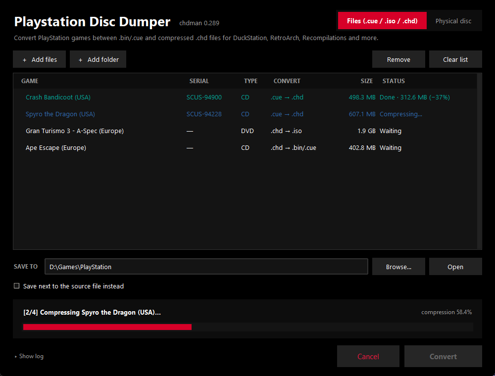

# Playstation Disc Dumper

A simple Windows app for converting PlayStation games to and from compressed **.chd** files, and for ripping physical PlayStation discs straight to .chd.

CHD files are typically 30–60% smaller than .bin/.cue or .iso images and work in DuckStation, RetroArch, Recompilations and more.



## Features

- **.bin/.cue or .iso → .chd**: compress PS1 and PS2 images. Multi-track games (separate audio tracks) are fully supported.
- **.chd → .bin/.cue or .iso**: turn a CHD back into a normal image. CD games become a single .bin with a .cue, DVD games become an .iso.
- **Rip physical discs**: read a PS1 or PS2 disc from your CD/DVD drive (raw 2352-byte sectors including audio tracks) and turn it into a .chd in one step. You can keep the .bin/.cue or .iso as well.
- **Batch conversion**: drag and drop files or whole folders. The list can mix both directions, and each game shows what it will be converted to.
- **Always verified**: every CHD that is created is checked with chdman before it is saved, and every CHD is checked before it is extracted. A damaged file produces an error instead of a broken image.
- **Safe on failure**: output goes to a temporary file first, so a cancelled or failed conversion never leaves a half-written file behind. Existing files are replaced only once the new one is complete.
- **Shows game serials** (e.g. `SCUS-94900`) read from .cue and .iso images and from discs.
- **Single .exe**: MAME's `chdman` is bundled, so nothing else needs to be installed.

## Download

Get **Playstation-Disc-Dumper.exe** from the [latest release](../../releases/latest) and run it. No installation is needed.

The exe is not code-signed, so Windows SmartScreen may show "Windows protected your PC" the first time. Click **More info → Run anyway**.

## Usage

### Converting files

1. Open the **Files** tab.
2. Drag in `.cue`, `.iso` or `.chd` files (or whole folders), or use **Add files** / **Add folder**. For .bin/.cue games, add the `.cue` file; the .bin files next to it are found automatically.
3. Choose where to save, or tick **Save next to the source file instead**.
4. Click **Convert**.

| Input | Output |
| --- | --- |
| `.cue` (+ `.bin`) | `.chd` |
| `.iso` | `.chd` |
| `.chd` (CD game) | `.bin` + `.cue` |
| `.chd` (DVD game) | `.iso` |

### Ripping a disc

1. Insert the disc and open the **Physical disc** tab.
2. Choose the drive and click **Read disc**. The disc type, serial and size are shown.
3. Adjust the file name if you like, then click **Rip & create CHD**.

Ripping needs free disk space for both the raw image and the CHD (about 1.7× the disc size) while it runs.

**Good to know about rips:**

- PAL PS1 games with LibCrypt copy protection also need a matching `.sbi` file next to the .chd in your emulator. Subchannel data is not read.
- Rips do not apply a drive read offset, so checksums may not match Redump even when the game works perfectly.

## Running from source

Requires Windows and Python 3.10 or newer (with tkinter, which the standard python.org installer includes). There are no other dependencies.

```bash
python PlaystationDiscDumper.pyw
```

Or double-click `run.bat`.

### Building the exe

```bash
build.bat
```

This creates a local build environment with PyInstaller and writes `dist\Playstation Disc Dumper.exe` with chdman bundled inside.

The icon is generated by `assets/make_icon.py` (needs Pillow); the resulting `icon.ico` is checked in.

## Project layout

| Path | Contents |
| --- | --- |
| `PlaystationDiscDumper.pyw` | The app (tkinter UI, conversion queue, chdman calls) |
| `discio.py` | Cue sheet parsing, serial detection, raw disc reading via SCSI pass-through |
| `tools/chdman.exe` | chdman from MAME 0.289 |
| `assets/` | App icon and the script that draws it |
| `build.bat` / `run.bat` | Build the exe / run from source |

## Settings

Settings (save folder and checkboxes) are stored in `%APPDATA%\PlaystationDiscDumper\settings.json`.

## License

Playstation Disc Dumper is licensed under the [GNU General Public License v3.0](LICENSE).

`tools/chdman.exe` is part of [MAME](https://www.mamedev.org/) and is distributed under the GNU General Public License v2.0. See [tools/MAME-LICENSE.txt](tools/MAME-LICENSE.txt). The corresponding source code is available from the [MAME 0.289 release](https://github.com/mamedev/mame/releases/tag/mame0289). MAME is a registered trademark of Gregory Ember.

This project is not affiliated with or endorsed by Sony Interactive Entertainment. "PlayStation" is a trademark of Sony Interactive Entertainment Inc. Only use it with games you own.
